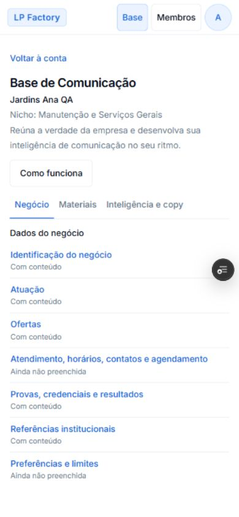
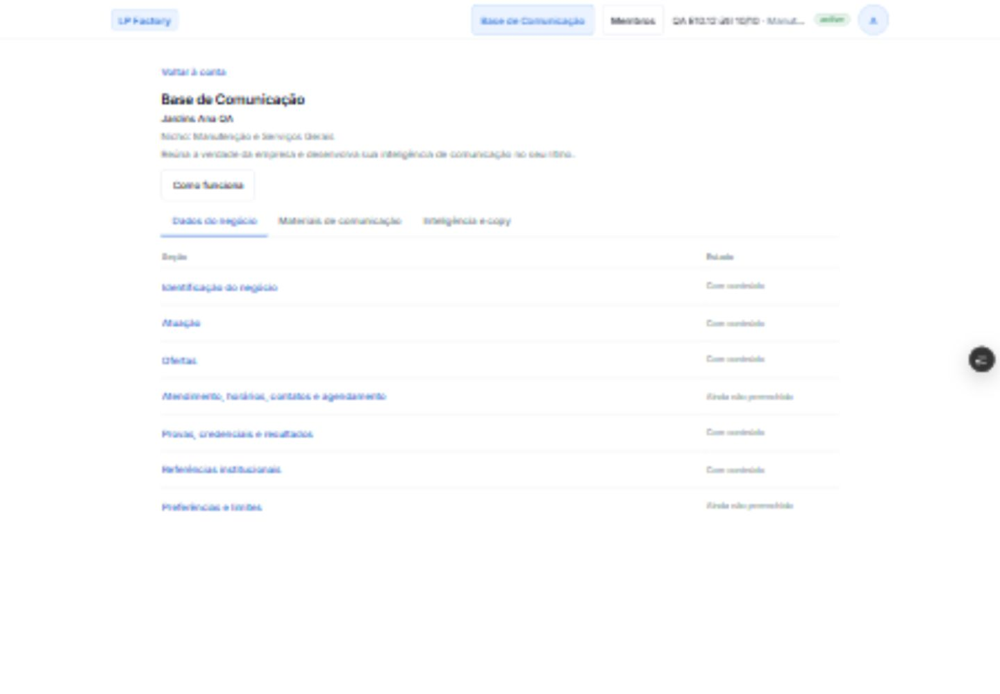
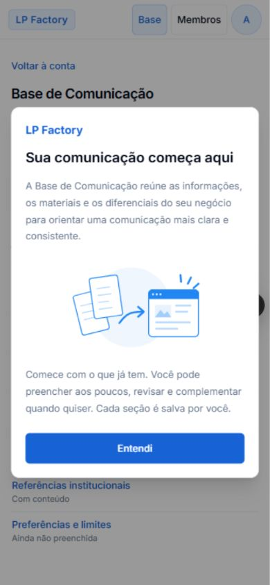
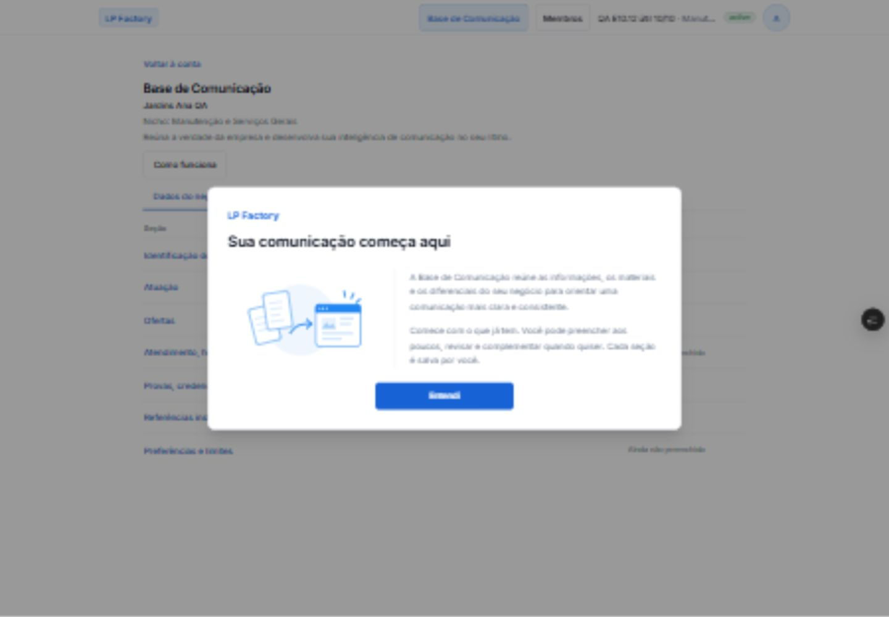
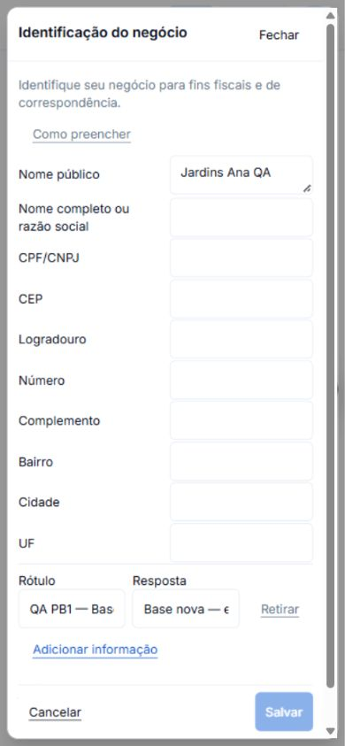
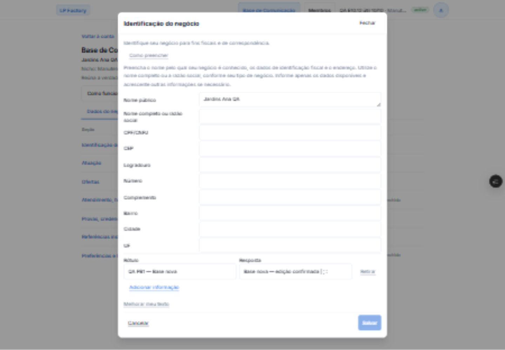
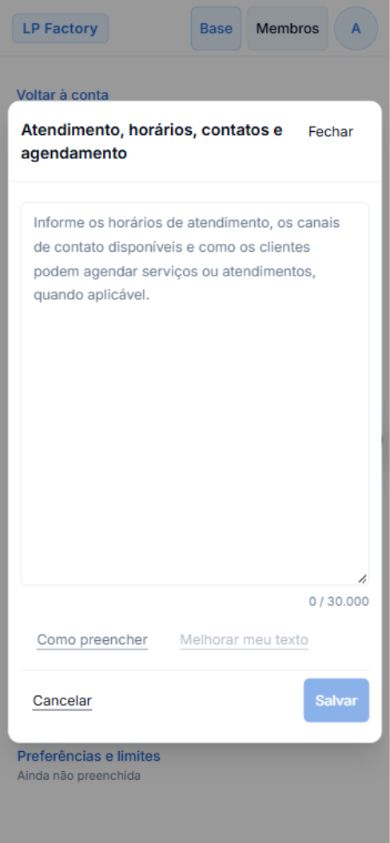
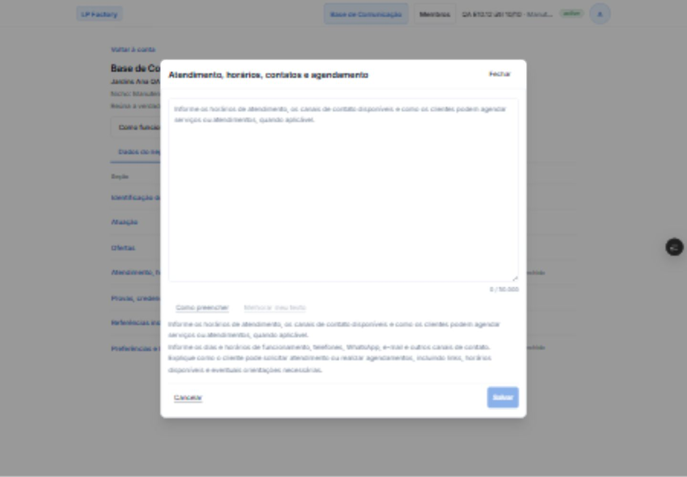

# QA do redesign — 04/11/2026

Implementação renderizada: 753ee73ef8dc23c97c272cd8891dcf365300d2ee. PR [#1117](https://github.com/AlcinoAfonso/LP-Factory-10/pull/1117), branch codex-app/base-comunicacao-redesign-20261104. [Preview](https://lp-factory-10-git-codex-app-base-27fb8c-alcino-afonsos-projects.vercel.app/a/qa-e10-12-useful-20261010/base-comunicacao), deployment Vercel HU8pCNepZc2G2vybnifYCSBunkQ5 READY. Conta de QA catalogada, sem credenciais neste registro. Nenhuma mutação persistente de negócio executada.

## Evidências renderizadas

| Superfície | Referência aprovada | Mobile 390 × 844 | Desktop 1440 × 1000 |
| --- | --- | --- | --- |
| Lista | [Mockup](01-pagina-inicial.png) |  |  |
| Apresentação | [Mockup](02-apresentacao.png) |  |  |
| Identificação | [Mockup](03-identificacao.png) |  |  |
| Editor | [Mockup](04-editor.png) |  |  |

Baseline real em Production (bca1e4f4), sem alteração de dados: [lista anterior](renderizado/baseline-pagina-390.jpg) e [editor anterior](renderizado/baseline-editor-390.jpg). As capturas são do navegador integrado; imagens desktop têm compressão/baixa nitidez, portanto cores e dimensões foram também medidas no DOM. A captura mobile da apresentação foi recapturada e inspecionada depois de um frame atrasado ser detectado na revisão de evidências.

## Verificações executadas

- Nas quatro superfícies, viewports 320, 390, 430, 1280 e 1440 px: sem overflow horizontal do documento ou popup. Popup preserva rolagem vertical e título completo; controles visíveis medidos com altura de pelo menos 44 px.
- Lista: coleção real e estados preservados, sem Abrir/coluna Ação; títulos acionam o mesmo dialog. Mobile tem estado abaixo do título; desktop mantém Seção/Estado. Categorias mantêm nomes acessíveis, seleção, Home e setas com foco.
- Apresentação: abertura inicial observada no primeiro login do Preview; Entendi, Escape, reabertura por Como funciona e retorno de foco funcionam. Título e dois parágrafos originais preservados.
- Seções 1.2–1.7: Textarea com name=value e maxLength=30000, sem Adicionar informação. Conteúdo salvo inicia com placeholder oculto. Campo vazio e foco sem escrita mantêm placeholder; digitação o oculta e apagar tudo o restaura.
- Rascunho de exatamente 30.000 caracteres com parágrafos/listas: contador 30.000 / 30.000 e Salvar disponível. Recusa client-side da assistência acima de 10.000 mantém o salvamento disponível e informa que nenhum texto foi enviado à IA. Nenhuma requisição de geração remota foi necessária.
- Como preencher: inicialmente recolhido, descrição e ajuda existentes acessíveis, Escape recolhe a ajuda sem fechar o editor. Cancelar com alteração abre confirmação; Continuar editando conserva o rascunho; descarte devolve foco ao mesmo título e reabertura mantém o valor persistido. Sem autosave.
- Identificação: todos os campos existentes preservados; Adicionar informação acrescenta Rótulo/Resposta; retirar o novo rascunho retorna ao estado limpo e desabilita Salvar.
- Materiais: controles de tipo, fonte por link, contexto e autorização preservados; abertura de rascunho de material cancelada sem persistência. Inteligência mantém listas e FAQ estruturados, pares Pergunta/Resposta, limites próprios e controles de revisão/pesquisa.
- Console do Preview sem erros/warnings na jornada observada. Auditoria local de AST confirma preservação literal dos textos JSX da apresentação/editor; diff confirma section-guidance.ts, policy.ts, actions.ts, StructuredSectionFields.tsx, CommunicationMaterials.tsx, Design System e AGENTS inalterados.

## Contraste e revisão

O primeiro parecer de gestor-design apontou exclusivamente contraste no HEAD 3ed724fa: títulos rgb(33,134,242) sobre branco (3,64:1) e Entendi (3,47:1). Correção local em 753ee73e, sem token global: brand-700 nos textos azuis e fundo do botão, com texto branco e variante escura existente para os links. Valores medidos no Preview: rgb(23,99,214) sobre branco = 5,54:1; Entendi branco sobre esse azul = 5,54:1; Como preencher rgb(100,116,139) sobre branco = 4,76:1. O retorno focal confirmou o fechamento do contraste e ganho de leitura da lista/prioridade de escrita em comparação à baseline. Não houve mudança de direção nem novo achado material comunicado.

Code Review independente inicial: [sem achados em 3ed724fa](https://github.com/AlcinoAfonso/LP-Factory-10/pull/1117#issuecomment-6636694251). Novo Code Review será solicitado no HEAD final, que inclui a correção e estas evidências. A inclusão documental das capturas não altera os blobs de runtime renderizados em 753ee73e.

## Checks e limites de prova

- npm ci executado com lockfile preservado. Auditoria reportou 19 vulnerabilidades nas dependências existentes; não houve upgrade ou correção de dependências neste recorte.
- npm run check aprovado antes e depois da correção de contraste: zero erros, 23 warnings de lint preexistentes. Inclui os seis round trips locais de 30.000 caracteres e os casos de capacidade de IA, formatos e guards. Auditoria focal de conteúdo/boundaries também aprovada.
- npm run dev iniciado em localhost:3000. A navegação local falhou por ausência de NEXT_PUBLIC_SUPABASE_URL/NEXT_PUBLIC_SUPABASE_PUBLISHABLE_KEY; o Preview autenticado supriu o QA renderizado sem copiar secrets/configuração. Sem npm run build no sandbox.
- Não foram feitos saves reais nem geração remota nesta execução, em respeito à proibição de mutação em conta ativa. A correção CRLF/persistência é inalterada e suas provas reais de salvar/reabrir 30.000 caracteres são as de [#1116](https://github.com/AlcinoAfonso/LP-Factory-10/pull/1116#issuecomment-6634551423), complementadas pela suíte local atual. Não apresentar isso como novo save e2e do redesign. Usar esta versão, resposta remota da IA e seus estados assíncronos não foram repetidos nesta jornada.
- Fonte ampliada não demonstrada: o atalho de zoom do navegador integrado não alterou a dimensão efetiva. Tema escuro não demonstrado por ausência de seletor disponível na aplicação; nenhum seletor foi criado. Teclado virtual móvel indisponível no runtime desktop.
- Base não iniciada, somente leitura, erro de consulta e nicho indefinido não foram produzidos na fixture atual. Fluxos e condições foram preservados por inspeção e checks, sem fabricar estado nem modificar conta ativa. Nome de negócio muito longo não foi persistido para demonstrar reflow; título longo de seção foi observado.
- As provas não constituem auditoria de conformidade WCAG integral. O PR permanece draft para avaliação humana e limites de QA explícitos. Merge proibido; nenhum merge ou mudança de banco/configuração foi executado.
